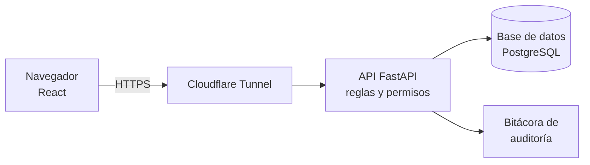

# Cómo funciona EduMaster.ai (explicación sencilla)

Guía para que todo el grupo pueda explicar el sistema. Cada idea tiene una comparación de la vida real.

## 1. Las piezas

- **Web (React):** la vitrina. Muestra datos y botones, pero no decide nada importante.
- **API (FastAPI):** el mostrador del banco. Toda petición pasa por aquí y aquí se revisan los permisos.
- **Base de datos:** la bóveda. Guarda instituciones, usuarios, roles y la bitácora.
- **Túnel de Cloudflare:** un pasillo seguro desde internet hasta la computadora que aloja el sistema,
  sin abrir puertas del router.

## 2. Iniciar sesión: el pase de 15 minutos

1. La persona escribe **institución + correo + contraseña**.
2. La API compara la contraseña con su "huella" guardada (nunca guarda la contraseña real).
3. Si es correcta entrega dos cosas:
   - **Pase de acceso (15 min):** como la pulsera de un evento. Se muestra en cada petición y caduca rápido.
   - **Ticket de renovación:** guardado en una cookie que JavaScript no puede leer. Sirve para pedir una
     pulsera nueva sin volver a escribir la contraseña.
4. **Cada ticket sirve una sola vez.** Si alguien intenta usar un ticket ya usado (señal de robo), se anulan
   todos los tickets de esa sesión y hay que volver a iniciar sesión.

Si la contraseña falla, el mensaje es siempre el mismo ("institución, correo o contraseña incorrectos") para no
darle pistas a un atacante. Tras 10 intentos por minuto desde la misma IP, se bloquea un momento.

## 3. Roles y permisos: llaves de un edificio

Cada rol es un llavero (§3). El administrador tiene la llave de "gestionar usuarios"; el estudiante no.
**La cerradura está en la API, no en la puerta pintada de la web:** aunque alguien fabrique un botón falso,
la API responde 403 ("no tienes permiso").

## 4. Varias instituciones: departamentos de un mismo edificio

Cada dato lleva el sello de su institución (`organization_id`). La API filtra todo por ese sello.
Si el administrador de ANDINO pide un usuario de PACIFICO, la respuesta es "no encontrado": ni siquiera
confirma que existe. Solo el superadministrador ve todos los departamentos.

## 5. La bitácora: la caja negra del avión

Cada acción importante (iniciar sesión, crear usuario, cambiar roles) queda anotada con quién, qué, cuándo,
desde qué IP y un `correlation_id`. En PostgreSQL la tabla **no permite modificar ni borrar** registros.

El `correlation_id` es como el número de seguimiento de un paquete: une la petición, los logs y el error,
para encontrar rápido qué pasó.

## 6. Honestidad de los datos

- Las instituciones y personas son **DEMO** (ficticias) y así se rotulan.
- Un panel sin datos reales muestra **en qué fase se construye**, nunca números inventados.
- La red neuronal se ve como **diseño**. Su animación solo aparece al pulsar "Simular", con la etiqueta
  "SIMULACIÓN DEMO", porque aún no hay un modelo entrenado (§1, §5.4).

## 7. Cómo se comprueba que funciona

- **24 pruebas automáticas de la API**: login, robo de sesión, permisos, aislamiento entre instituciones,
  bitácora y panel.
- **GitHub Actions (CI)** repite las pruebas contra PostgreSQL real, verifica las migraciones y que la
  bitácora rechace borrados, y compila la web.
