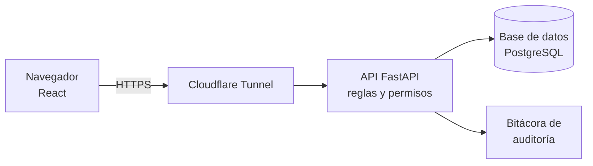

# Cómo funciona EduMaster.ai (explicación sencilla)

Guía para que todo el grupo pueda explicar el sistema. Cada idea tiene una comparación de la vida real.

## 1. Las piezas

- **Web (React):** la vitrina. Muestra datos y botones, pero no decide nada importante.
- **API (FastAPI):** el mostrador del banco. Toda petición pasa por aquí y aquí se revisan los permisos.
- **Base de datos:** la bóveda. Guarda instituciones, usuarios, roles y la bitácora.
- **Túnel de Cloudflare:** un pasillo seguro desde internet hasta la computadora que aloja el sistema,
  sin abrir puertas del router.

## 2. Iniciar sesión: el pase de 15 minutos

1. La persona escribe **institución + correo + contraseña**.
2. La API compara la contraseña con su "huella" guardada (nunca guarda la contraseña real).
3. Si es correcta entrega dos cosas:
   - **Pase de acceso (15 min):** como la pulsera de un evento. Se muestra en cada petición y caduca rápido.
   - **Ticket de renovación:** guardado en una cookie que JavaScript no puede leer. Sirve para pedir una
     pulsera nueva sin volver a escribir la contraseña.
4. **Cada ticket sirve una sola vez.** Si alguien intenta usar un ticket ya usado (señal de robo), se anulan
   todos los tickets de esa sesión y hay que volver a iniciar sesión.

Si la contraseña falla, el mensaje es siempre el mismo ("institución, correo o contraseña incorrectos") para no
darle pistas a un atacante. Tras 10 intentos por minuto desde la misma IP, se bloquea un momento.

## 3. Roles y permisos: llaves de un edificio

Cada rol es un llavero (§3). El administrador tiene la llave de "gestionar usuarios"; el estudiante no.
**La cerradura está en la API, no en la puerta pintada de la web:** aunque alguien fabrique un botón falso,
la API responde 403 ("no tienes permiso").

## 4. Varias instituciones: departamentos de un mismo edificio

Cada dato lleva el sello de su institución (`organization_id`). La API filtra todo por ese sello.
Si el administrador de ANDINO pide un usuario de PACIFICO, la respuesta es "no encontrado": ni siquiera
confirma que existe. Solo el superadministrador ve todos los departamentos.

## 5. La bitácora: la caja negra del avión

Cada acción importante (iniciar sesión, crear usuario, cambiar roles) queda anotada con quién, qué, cuándo,
desde qué IP y un `correlation_id`. En PostgreSQL la tabla **no permite modificar ni borrar** registros.

El `correlation_id` es como el número de seguimiento de un paquete: une la petición, los logs y el error,
para encontrar rápido qué pasó.

## 6. Rutas de aprendizaje: la malla curricular

- Una ruta es una secuencia de cursos con un objetivo y competencias (p. ej. «Analista de datos junior»:
  PY-101 → DS-201 → ML-301). Cada etapa se habilita al cumplir la anterior: completar el curso y, si se exige,
  sacar una nota mínima.
- Coordinación la asigna a una cohorte completa o a personas, con fecha objetivo. Si alguien ya domina un curso
  (por ejemplo, lo convalidó), se le dispensa esa etapa con un motivo que queda registrado.
- Si se cambia una ruta ya publicada, sube su versión y el cambio queda en el historial (sale de la bitácora).
- El estudiante ve su línea de tiempo: qué etapa terminó, cuál cursa, cuáles siguen bloqueadas y si va a tiempo.

## 7. Lecciones y contraseñas

- Cada lección tiene su texto (con títulos, listas y código), enlaces a recursos y un video opcional. El docente la
  edita y cada cambio crea una versión nueva con su nombre y fecha. El texto se muestra siempre como texto: aunque
  alguien escriba código malicioso, no se ejecuta.
- Cualquiera cambia su contraseña desde «Mi perfil». Si alguien la olvida, la administración genera una temporal que
  se ve una sola vez; al entrar con ella, el sistema no deja hacer nada más hasta elegir una nueva.

## 8. Cursos, progreso y notas: el cuaderno de control

- **Curso** = el libro (unidades y actividades). **Oferta** = el salón que lo dicta este periodo, con su
  docente y su grupo (cohorte). **Matrícula** = el estudiante sentado en ese salón.
- Cada vez que el estudiante abre o termina una actividad, se envía un **evento** con un número único
  (`event_id`). Si por mala conexión llega dos veces, se cuenta una sola: como un ticket que ya fue sellado.
- **Progreso** = actividades obligatorias terminadas ÷ total. Al llegar al 100 % la matrícula pasa a "Completado".
- **Nota oficial**: la pone el docente (escala 0-20) y cada cambio queda en la bitácora. La IA nunca califica.
- Cada rol ve lo que le corresponde: el docente solo sus salones, el estudiante solo los suyos y el analista
  solo totales, sin notas con nombre (§3).

## 9. La IA de riesgo de abandono: un termómetro, no un juez

1. **Datos de práctica:** un simulador crea ~13 400 matrículas ficticias con comportamientos realistas
   (quien estudia constante, quien se va desconectando, quien hace una pausa y vuelve). Todo es DEMO.
2. **La pregunta:** ¿este estudiante pasará los próximos 14 días sin conectarse? Solo se miran datos de
   *antes* del momento de la predicción (si no, sería "hacer trampa" mirando el futuro).
3. **Competencia justa:** se entrenan tres modelos: regresión logística, Gradient Boosting y la red neuronal
   (rama de números + GRU que "lee" las últimas 6 semanas como una película). La red solo se publica si le gana
   al modelo simple; ganó por poco y así queda escrito en la model card.
4. **Probabilidades honestas:** se calibran para que "80 %" signifique que, de cada 10 casos así, unos 8 se
   desconectan.
5. **Aprobación humana:** el ML Engineer entrena y registra; el administrador revisa la ficha y aprueba. Sin
   esa firma, la IA no se usa en la institución.
6. **Uso:** el docente ve "alto · 81 %" y los factores (por ejemplo, "varios días sin conectarse"). Decide él:
   marca la alerta como atendida o la descarta explicando por qué. El estudiante no ve su puntaje.
7. **Ligero en el servidor:** la API no carga PyTorch; usa los pesos exportados con NumPy y una prueba
   confirma que da el mismo resultado.

## 10. Recomendaciones e IA Tutor: un GPS de estudio

- El estudiante pregunta «¿qué hago ahora?» y el tutor revisa su situación real en el curso:
  - **Siguiente actividad** obligatoria, indicando si va atrasado frente al calendario.
  - **Entrega próxima** que vence en menos de 7 días y aún no envía.
  - **Reforzar** un tema si su nota oficial quedó por debajo del 55 %.
  - **Retomar** con la actividad más corta si lleva 7 días o más sin entrar.
- Cada sugerencia dice **por qué** y qué ganaría. El estudiante la acepta, la descarta o dice si le sirvió.
- Cuando cumple (completa la actividad o entrega), la sugerencia se cierra sola como «completada»; si la
  situación cambia sin hacerlo, queda «expirada». Lo descartado no se vuelve a insistir.
- El modelo de riesgo solo decide qué tan arriba va «retomar»; el estudiante nunca ve su puntaje.
- El docente ve las sugerencias de su grupo, y la coordinación mide aceptación y utilidad (no solo clics).

## 11. Notificaciones en vivo: el timbre

- Cuando pasa algo que te importa (te ponen nota, hay una evaluación nueva, se emite tu certificado, aparecen
  alertas en tu curso), la campana suma un número y sale un aviso al instante, sin recargar la página.
- Funciona con **Server-Sent Events**: el navegador deja una línea abierta y el servidor "toca el timbre".
- La notificación se guarda junto con la acción; solo se anuncia si la acción se guardó de verdad.
- Si se corta internet, al volver el navegador pide "lo que me perdí desde el último aviso".
- Cada persona recibe solo lo suyo: no hay un canal general con datos de todos (§10.4).

## 12. Certificados: el diploma con código

- Se emite solo al completar todas las actividades obligatorias, con nota final de 11 o más y al menos la mitad
  del peso ya calificado. La IA no interviene.
- Tiene **folio único** y un **código de 10 letras** con QR. Cualquiera lo verifica en `/verificar/<código>` sin
  iniciar sesión, y solo ve nombre, curso, institución, folio y estado (sin notas ni correos).
- Si hay un error, la administración lo **anula** con motivo; la verificación pasa a decir "ANULADO" y se puede
  emitir uno nuevo. Emisión, descarga y anulación quedan en la bitácora.

## 13. Mapa y comunidad

- **Mapa:** la vista **Mundo** muestra cuántos estudiantes hay por continente; hoy todos son DEMO del Perú, así que solo brilla Sudamérica. La vista **Perú** muestra cada departamento como un cuadrado (cartograma) pintado según el progreso promedio de sus estudiantes.
  Si una región tiene menos de 3 personas, no se muestra ni se nombra: con tan pocos sería fácil adivinar quién es.
- **Comunidad:** cada curso tiene su espacio. El docente publica anuncios (llegan como notificación), cualquiera del
  curso abre debates y responde, y quien escribió recibe aviso de las respuestas.
- **Moderación:** cualquiera reporta un mensaje que incumple las reglas; el docente lo oculta con un motivo (queda en
  la bitácora) o desestima el reporte. Nada se borra. Cada persona puede silenciar los avisos de un curso.

## 14. Analítica: el tablero con letra chica a la vista

- Nueve indicadores (participación, tiempo activo, entregas a tiempo, progreso, finalización, nota…) y cada uno
  muestra su **definición exacta** al pasar el cursor: así nadie interpreta el mismo número de dos formas.
- Se filtra por fechas, oferta, cohorte, docente y periodo; los mismos filtros se aplican a lo que se exporta.
- La exportación (CSV, Excel o PDF) lleva en el encabezado la fecha y los filtros, y queda en la bitácora.
- El analista ve solo totales; los nombres de estudiantes los ven la gestión, el docente (sus cursos) y la auditoría.

## 15. Dominio de habilidades: el estimado y el oficial

- Las competencias se organizan en áreas (Programación → Sintaxis de Python, Control de flujo…). Cada curso dice qué
  competencias trabaja y cada evaluación cuáles evidencia.
- El sistema **estima** un nivel (principiante → experto) con las notas oficiales y el avance de cada unidad. Con poca
  evidencia es prudente: no sube el nivel por un solo dato.
- El **docente valida** el nivel oficial con una nota de lo que observó. Ambos se muestran por separado: la estimación
  orienta, la validación decide (§4.9).
- El heatmap muestra cuántos estudiantes hay en cada nivel por competencia, estimado o validado.

## 16. Honestidad de los datos

- Las instituciones y personas son **DEMO** (ficticias) y así se rotulan.
- Un panel sin datos reales muestra **en qué fase se construye**, nunca números inventados.
- La red neuronal se ve como **diseño**. Su animación solo aparece al pulsar "Simular", con la etiqueta
  "SIMULACIÓN DEMO" mientras la institución no aprueba un modelo (§1, §5.4).

## 17. Cómo se comprueba que funciona

- **98 pruebas automáticas de la API**: login, robo de sesión, permisos, aislamiento entre instituciones,
  bitácora, cursos, eventos idempotentes, entregas, notas, panel, aprobación del modelo, predicción, revisión,
  recomendaciones, notificaciones en vivo, certificados, mapa, comunidad, rutas, analítica, habilidades, lecciones y contraseñas.
- **5 pruebas de ML**: sin fuga de información, definición de la etiqueta, simulación reproducible y
  NumPy = PyTorch.
- **27 pruebas E2E (Playwright)**: un navegador real recorre la web como lo haría una persona: inicia sesión, marca
  actividades, pide ayuda al IA Tutor, recibe una nota en vivo mientras otro navegador califica, aprueba el modelo,
  verifica un certificado sin sesión, exporta analítica y valida una competencia. También revisa accesibilidad
  y que en celular no haya desplazamiento horizontal.
- **GitHub Actions (CI)** repite las pruebas contra PostgreSQL real, verifica las migraciones y que la
  bitácora rechace borrados, y compila la web.
