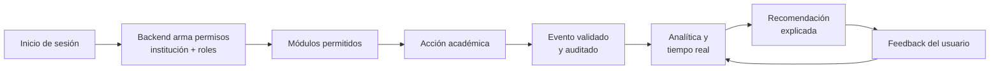

# Mapa de procesos

Resumen de los flujos de §4 y del manual (§5). Cada flecha es una acción verificada por el backend.

## Ciclo de uso general

## Procesos por fase

| Proceso | Actores | Fase |
|---|---|---|
| Iniciar sesión y renovar sesión | Todos | 1 |
| Gestionar usuarios y roles de la institución | Administrador institucional | 1 |
| Crear instituciones | Superadministrador | 1 |
| Consultar bitácora | Auditor, administrador | 1 |
| Publicar curso y asignar docente | Administrador | 2 |
| Crear y asignar ruta | Coordinador | 2 |
| Publicar y calificar evaluación | Docente → estudiante | 2 |
| Consumir contenido y generar eventos | Estudiante | 2 |
| Ver indicadores en tiempo real | Todos según permisos | 3 |
| Preparar dataset | Analista de datos | 4 |
| Entrenar, evaluar y publicar modelo | ML Engineer + aprobador | 5 |
| Recibir y valorar recomendaciones | Estudiante, docente | 6 |
| Emitir y verificar certificado | Sistema, tercero | 2-3 |

## Regla transversal
Toda acción pasa por: **autenticación → permiso del rol → filtro de institución → regla de negocio →
persistencia → auditoría → evento**. Ocultar un botón en la interfaz nunca reemplaza esta cadena (§3).
